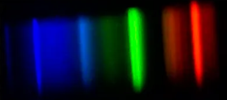
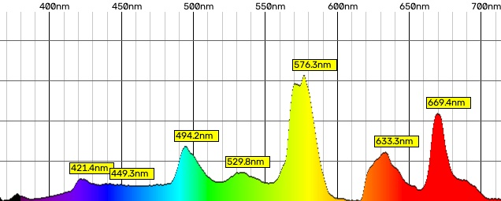

# PySpectrometer (Image Folder Edition)

[](LICENSE)
[](https://www.python.org/)
[](#testing-and-quality-assurance)
[](#prerequisites)

A desktop optical spectroscopy application and Python library designed for processing, calibrating, and analyzing pre-captured diffraction spectrum images.

---

## Overview

PySpectrometer (Image Folder Edition) decouples physical camera hardware from spectral analysis. While traditional DIY spectrometers require a live webcam or Raspberry Pi camera stream during acquisition, this edition allows researchers, educators, and hobbyists to analyze static spectrum photographs captured previously on smartphones, digital cameras, or benchtop optical setups.

The application computes intensity distributions across user-defined optical cross-sections, applies mathematical filtering, performs interactive or automated two-point wavelength calibrations, detects spectral emission peaks, and exports calibrated scientific datasets in standard CSV and JPEG formats.

Based on the original *Python Picam/Webcam Spectrometer* by Les Wright (May 2021) and modifications by Florian Ragwitz (V3.1).

---

## Sample Visualization

### Input Spectrum Image
Horizontal diffraction spectrum captured through an optical transmission grating:



### Calibrated Output Graph
Processed spectrum showing wavelength-calibrated axis (nm), real-time peak identification boxes, and physical RGB color dispersion:



---

## Key Features

- **Offline Analysis**: Analyze static image files or entire directories of captures without optical hardware attached to the host computer.
- **Universal Image Support**: Decodes JPEG, PNG, BMP, TIFF, WebP, JFIF, PPM, PGM, PBM, and GIF formats.
- **Cross-Platform Resilience**: Native handling of UTF-8 and Unicode directory paths on Windows, macOS, and Linux, with automatic EXIF orientation normalization.
- **Interactive Two-Point Calibration**: Establish exact pixel-to-nanometer scaling by clicking reference peaks on the graph and inputting known emission values.
- **Command-Line Calibration**: Pass preset calibration tuples directly via CLI flags for batch automated workflows.
- **Noise Suppression**: Adjustable Savitzky-Golay polynomial smoothing filter to remove sensor noise while preserving sharp spectral peaks.
- **Peak Detection**: Real-time peak finding powered by PeakUtils with adjustable minimum distance and intensity threshold sliders.
- **Peak Hold Accumulation**: Retain and accumulate maximum spectral intensities across multiple sequential images or fluctuating sources.
- **Scientific Data Export**: One-click snapshots saving publication-ready JPEG spectrum plots alongside raw tabular CSV files (Wavelength vs. Intensity).
- **Headless API**: Core analysis engine (`ImageSpectrometer`) can be imported directly into Python scripts, scientific pipelines, or Jupyter notebooks without launching the graphical interface.

---

## Optical Principles and Calibration Model

A transmission diffraction grating disperses incident light according to the grating equation:

```text
d * (sin(alpha) + sin(beta)) = m * lambda
```

For planar CMOS sensors operating over the visible range (380 nm to 750 nm) at small angles of incidence, the dispersion along the horizontal sensor axis is modeled as a linear system:

```text
lambda(x) = lambda_0 + (d_lambda / dx) * x
```

Where:
- `x` represents horizontal sensor pixel position.
- `lambda_0` is the extrapolated zero-pixel wavelength intercept.
- `d_lambda / dx` is the reciprocal linear dispersion (nm per pixel).

PySpectrometer calculates these parameters from two known reference points:

```text
nm_per_pixel = |wavelength_2 - wavelength_1| / |pixel_2 - pixel_1|
zero_wavelength = wavelength_1 - (pixel_1 * nm_per_pixel)
```

For complete reference emission lines (mercury-vapor lamps, diode lasers, and solar Fraunhofer lines), refer to the [Calibration Guide](docs/CALIBRATION_GUIDE.md).

---

## Directory Structure

```text
spectrometer/
├── .github/
│   ├── ISSUE_TEMPLATE/
│   │   ├── bug_report.md
│   │   └── feature_request.md
│   ├── workflows/
│   │   └── ci.yml
│   └── pull_request_template.md
├── docs/
│   ├── images/
│   │   ├── sample_spectrum.png
│   │   └── sample_spectrum_graph.jpg
│   └── CALIBRATION_GUIDE.md
├── samples/
│   ├── sample_spectrum.csv
│   └── sample_spectrum.png
├── tests/
│   ├── __init__.py
│   └── test_spectrometer.py
├── .gitattributes
├── .gitignore
├── CHANGELOG.md
├── CONTRIBUTING.md
├── LICENSE
├── README.md
├── SECURITY.md
├── pyproject.toml
├── requirements-dev.txt
├── requirements.txt
└── pyspectrometer_image_folder.py
```

---

## Prerequisites

- **Python**: Version 3.8 or newer (3.8 through 3.14 supported).
- **Operating System**: Windows 10/11, macOS 10.15+, or modern Linux distributions.

### Linux System Dependencies
On Debian or Ubuntu-based distributions, ensure Tkinter and X11/OpenGL libraries are installed:

```bash
sudo apt-get update
sudo apt-get install -y python3-tk libgl1-mesa-glx libglib2.0-0
```

---

## Installation

### Method 1: Standard Virtual Environment (Recommended)

1. Clone or download the repository:
   ```bash
   git clone https://github.com/leswright177/PySpectrometer.git
   cd PySpectrometer
   ```

2. Create and activate a Python virtual environment:
   ```bash
   # Linux / macOS
   python3 -m venv .venv
   source .venv/bin/activate

   # Windows (PowerShell)
   python -m venv .venv
   .venv\Scripts\Activate.ps1
   ```

3. Install core dependencies:
   ```bash
   pip install -r requirements.txt
   ```

### Method 2: Editable Package Installation

To install PySpectrometer as an executable console command (`pyspectrometer`):

```bash
pip install -e .
```

---

## Usage

### Graphical Interface

Launch PySpectrometer directly with Python:

```bash
python pyspectrometer_image_folder.py
```

If installed as a package:

```bash
pyspectrometer
```

#### Opening an Image or Folder at Startup
Pass a specific image file or a directory containing multiple spectrum images:

```bash
# Analyze a single image
python pyspectrometer_image_folder.py --folder samples/sample_spectrum.png

# Analyze a directory of images
python pyspectrometer_image_folder.py --folder /path/to/spectrum_images
```

#### Pre-Configuring Calibration from CLI
Provide pixel-to-wavelength coordinates via the `-c` / `--calibration` argument:

```bash
python pyspectrometer_image_folder.py --folder samples/sample_spectrum.png -c 72:405,304:532
```

Supported calibration syntax:
- `pixel1:nm1,pixel2:nm2` (e.g. `72:400,304:530`)
- `pixel1:nm1;pixel2:nm2` (e.g. `72:405; 304:532`)
- Floating-point wavelengths (e.g. `72:404.7,304:532.0`)

---

## User Interface and Controls

| UI Control | Category | Functionality |
| :--- | :--- | :--- |
| **Open Folder...** | File Management | Selects a directory containing spectrum images; loads images sorted alphanumerically. |
| **Open Image...** | File Management | Loads an individual spectrum image for standalone analysis. |
| **< Prev / Next >** | Navigation | Cycles sequentially through images within the loaded directory. |
| **Clear** | Calibration | Resets current calibration points to permit clicking new reference coordinates. |
| **Calibrate** | Calibration | Validates entry inputs and computes pixel-to-wavelength scaling. |
| **Peak Width** | Signal Processing | Adjusts minimum distance (in pixels) between detected peaks. |
| **Threshold** | Signal Processing | Adjusts sensitivity threshold percentage for peak recognition. |
| **Filter** | Signal Processing | Adjusts polynomial order of Savitzky-Golay smoothing filter (0 to 16). |
| **Peak Hold** | Accumulation | Toggles peak accumulation across successive frames or images. |
| **Snapshot** | Data Export | Writes high-resolution JPEG graph and CSV spectral dataset to disk. |

---

## Calibration Procedure

1. Open a spectrum image containing known reference lines (e.g. a fluorescent light bulb or known lasers).
2. Click **Clear** to reset existing marker points.
3. Click directly on the first reference peak on the lower intensity graph. The clicked X-pixel coordinate will appear in the marker box.
4. Enter the known wavelength (nm) in the `Wavelength 1` text box (e.g. `405`).
5. Click on the second reference peak on the intensity graph.
6. Enter the known wavelength (nm) in the `Wavelength 2` text box (e.g. `532`).
7. Click **Calibrate**. The button will turn yellow, and the nanometer axis markings will update across the graph canvas.

For detailed emission reference tables and instructions, see the [Calibration Guide](docs/CALIBRATION_GUIDE.md).

---

## Scientific Data Export Format

When clicking **Snapshot**, PySpectrometer outputs two synchronized files named `<source_filename>-<timestamp>`:

### 1. High-Resolution Graph (`.jpg`)
A 636x255 pixel render containing:
- Intensity curves with physical visible-light RGB spectrum coloration.
- Wavelength grid lines at 10 nm (minor) and 50 nm (major) intervals.
- Numerical nanometer peak annotations in high-contrast bounding boxes.

### 2. Tabular Data (`.csv`)
A standard comma-delimited text file containing exact measured data points:

```csv
Wavelength,Intensity
392.40,14
392.83,16
393.25,18
...
700.12,2
```

---

## Programmatic API (Headless Usage)

The `ImageSpectrometer` class can be integrated into custom scientific scripts without running Tkinter:

```python
from pyspectrometer_image_folder import ImageSpectrometer

# Initialize with calibration coordinates: ((pixel1, nm1), (pixel2, nm2))
calibration = ((72, 405), (304, 532))
spectrometer = ImageSpectrometer(calibration)

# Load spectrum image
success = spectrometer.load_folder("samples/sample_spectrum.png")
if success:
    # Generate graph data
    ret, (graph_image, wavelengths, intensities) = spectrometer.get_graph()
    if ret:
        print(f"Total data points: {len(wavelengths)}")
        print(f"Wavelength range: {wavelengths[0]:.1f} nm to {wavelengths[-1]:.1f} nm")
        print(f"Peak intensity: {max(intensities)} at {wavelengths[intensities.index(max(intensities))]} nm")
```

---

## Testing and Quality Assurance

PySpectrometer includes a comprehensive automated test suite validating optical calculations, calibration syntax, file decoding, and signal processing mechanics.

To execute tests locally:

```bash
# Using standard Python unittest
python -m unittest discover -s tests

# Using pytest
pytest
```

---

## Contributing

Contributions, bug reports, and pull requests are welcomed. Please review [CONTRIBUTING.md](CONTRIBUTING.md) for development workflows, testing expectations, and contribution standards.

---

## License

This project is licensed under the **Apache License, Version 2.0**. See the [LICENSE](LICENSE) file for terms and conditions.

### Acknowledgments and Upstream Attribution
- Original implementation by **Les Wright** (May 2021).
- V3.1 modifications and enhancements by **Florian Ragwitz**.
- Image Folder Edition enhancements by repository contributors.
